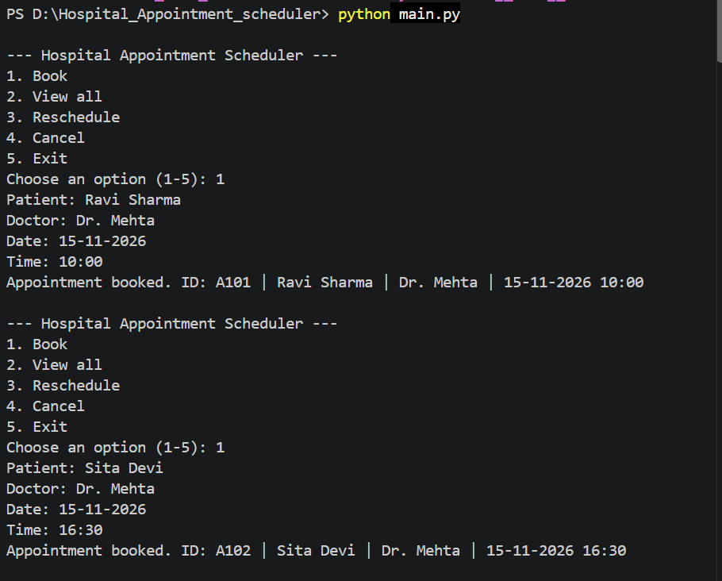
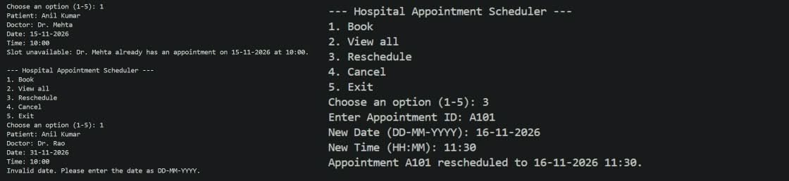
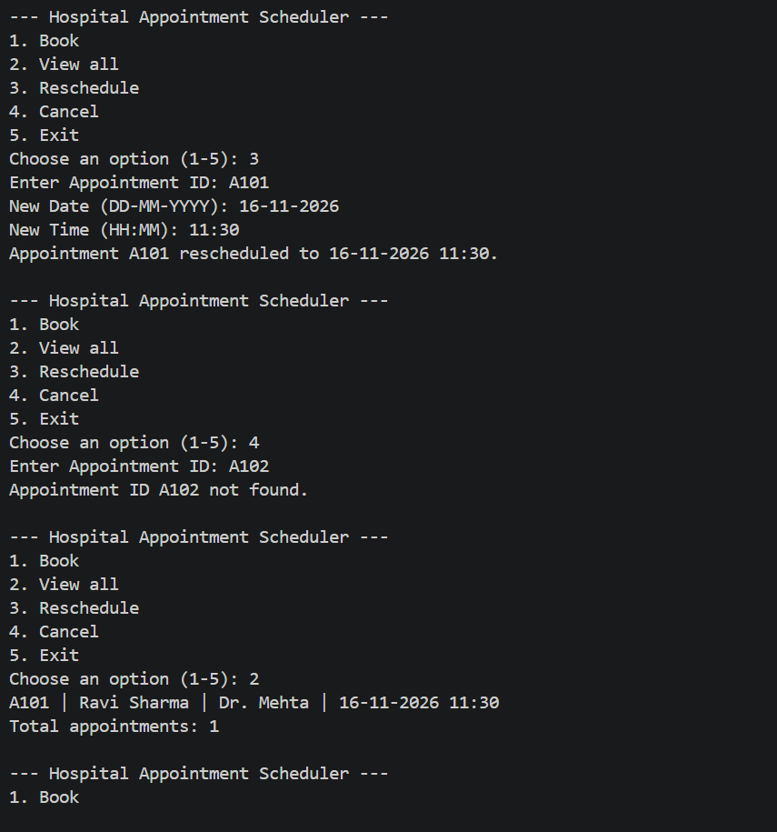

# Hospital Appointment Scheduler (PS No. 78)

## Project Overview
A console-based Python application built for a clinic receptionist to manage patient appointments efficiently. The system handles booking, viewing, rescheduling, and cancelling appointments while enforcing doctor availability and strict 30-minute time slot validations.

*Student Name:* Ankit Kumar Gupta  
*Institution:* Rungta International Skills University (School of Computer Science and Engineering)  
*Program:* B.Tech CSE (AI in association with Google) – First Semester  
*Language:* Python 3  

---

## Features & Rules
- *Auto-Generated IDs:* Starts sequentially from A101 (A101, A102, ...).
- *Supported Doctors:* Dr. Mehta, Dr. Rao.
- *Slot Management:* Accepts only 30-minute intervals between 09:00 and 16:30 (e.g., 09:00, 09:30, ..., 16:30).
- *Date & Time Validation:* Uses Python's built-in datetime module to enforce DD-MM-YYYY and HH:MM formats and reject invalid calendar dates (e.g., 31-11-2026).
- *Conflict Prevention:* Prevents double-booking the same doctor on the same date and time.
- *CRUD Operations:* Supports Create (Book), Read (View all), Update (Reschedule), and Delete (Cancel) operations via an interactive menu loop.

---

## Project Structure & Required Files
- *Python Version:* Python 3.x (Uses built-in datetime module; no external libraries required).
- *Files Included:*
  - main.py – Core application logic and CLI menu.
  - README.md – Project overview, setup guide, and output screenshots.
  - summary.md – Technical summary and viva notes.
  - screenshot/ – Folder containing terminal execution screenshots.

---

## How to Run
1. Open terminal / command prompt in the project directory.
2. Run the command:
   ```bash
   python main.py 
   ```## Output Screenshots

### 1. Normal & Boundary Booking (Test Case 1 & 2)


### 2. Invalid Slot & Date Validation (Test Case 3)


### 3. Reschedule, Cancel & View All (Test Case 4)

